# Práctico 2 — Mitigación de Vulnerabilidades

## Introducción

El presente documento registra el proceso de análisis, identificación, comprobación y mitigación de las vulnerabilidades incluidas en cada uno de los ejercicios del práctico. La documentación se organiza de forma cronológica, procurando reflejar cómo se detectó cada comportamiento vulnerable, qué pruebas se realizaron para validar su impacto, qué modificación se aplicó y cómo se verificó posteriormente la corrección.

Las pruebas se realizaron exclusivamente sobre los entornos provistos para el práctico y se acompañan, cuando corresponde, de fragmentos de código, comandos y capturas de pantalla que documentan cada etapa del proceso.

## Ejercicio 1 — Inyección SQL (SQLi)

### 1. Identificación de la vulnerabilidad

Este ejercicio utiliza **CineBuscador**, una aplicación web desarrollada con Flask para buscar funciones de cine. Como primera etapa del análisis, revisé el archivo `Ejercicio1/app.py` e identifiqué la función `buscar_funciones`, responsable de construir la consulta SQL:

```python
def buscar_funciones(query, sort_by='nombre', sort_dir='ASC'):
    db = get_db()
    sql = f"SELECT peliculas.nombre as pelicula, funciones.fecha_hora, " \
          f"(funciones.asientos_totales - funciones.asientos_ocupados) as disponibles " \
          f"FROM funciones " \
          f"JOIN peliculas ON funciones.pelicula_id = peliculas.id " \
          f"WHERE peliculas.nombre LIKE '%{query}%' " \
          f"ORDER BY {'peliculas.nombre' if sort_by == 'nombre' else 'funciones.fecha_hora'} " \
          f"{sort_dir}"
    return db.execute(sql).fetchall()
```

El primer punto relevante se encuentra en la línea 29: `WHERE peliculas.nombre LIKE '%{query}%'`. El valor `query` proviene directamente de lo ingresado en el buscador (`request.args.get('buscar', '')`, línea 37), y, en lugar de transmitirse como un parámetro independiente, se inserta dentro de un *f-string*. Esto implica que la entrada del usuario puede modificar directamente la consulta SQL que ejecuta la aplicación.

### 2. Proceso de comprobación (PoC)

#### Paso 1 — Confirmación de la alteración de la consulta

La primera prueba consistió en introducir una comilla simple al final del término de búsqueda: `Dune'`. La consulta resultante queda construida de la siguiente forma:

```
...LIKE '%Dune'%' ORDER BY peliculas.nombre ASC
```

SQLite devolvió el error `unrecognized token: "' ORDER BY peliculas.nombre ASC"`.

Este resultado confirmó que la entrada del usuario estaba alterando la sintaxis SQL y, por lo tanto, no estaba siendo tratada únicamente como un valor de texto.

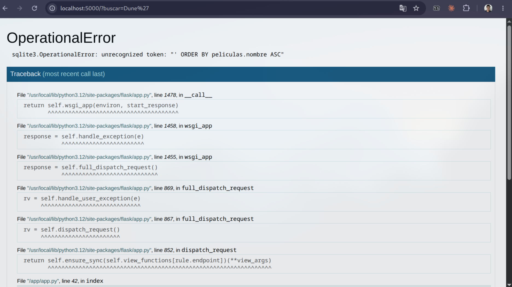

#### Paso 2 — Extracción de información mediante `UNION SELECT`

Una vez confirmada la alteración de la consulta, continué evaluando el alcance de la vulnerabilidad. Dado que el `SELECT` original devuelve tres columnas (`pelicula`, `fecha_hora`, `disponibles`), construí un `UNION SELECT` con la misma cantidad de columnas para que el resultado fuera compatible con la consulta original y pudiera mostrarse en la tabla de resultados. El payload utilizado en `buscar` fue:

```
zzz' UNION SELECT nombre || ' | dir=' || director || ' | genero=' || genero, '2000-01-01 00:00', 1 FROM peliculas --
```

La lógica de la prueba es la siguiente: `zzz'` hace que la búsqueda original no encuentre nada (no hay ninguna película que se llame "zzz"), y el `--` al final comenta lo que Flask agrega después (el `%' ORDER BY ...`). Al ejecutar la prueba, en lugar de obtener una búsqueda sin resultados, la columna de "película" mostró valores como los siguientes:

```
Dune: Parte Dos | dir=Denis Villeneuve | genero=Ciencia Ficción
Oppenheimer | dir=Christopher Nolan | genero=Drama/Biografía
```

Esto permitió comprobar que `director` y `genero` son columnas que la interfaz web no expone normalmente — la tabla de resultados solo tiene nombre, fecha y asientos disponibles. Por lo tanto, el buscador permitía recuperar información que no estaba prevista para ser expuesta por la aplicación.

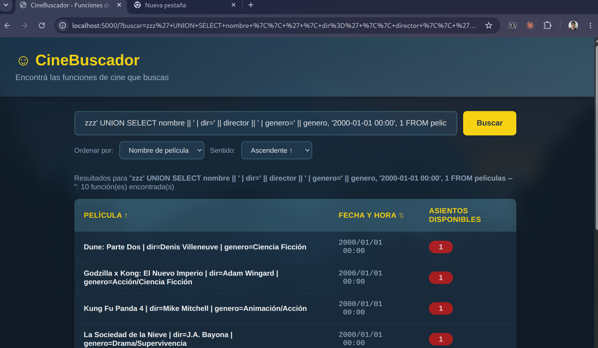

#### Paso 3 — Enumeración del esquema de la base de datos

A continuación, amplié la prueba utilizando el siguiente payload:

```
zzz' UNION SELECT name || ': ' || sql, '2000-01-01 00:00', 1 FROM sqlite_master --
```

El resultado devolvió las sentencias `CREATE TABLE` completas de las tres tablas de la base (`peliculas`, `funciones` y `sqlite_sequence`). En este ejercicio no existe una tabla de usuarios o contraseñas. Sin embargo, la prueba demuestra que la misma técnica permite enumerar las tablas existentes (vía `sqlite_master`) y posteriormente construir consultas orientadas a tablas específicas. En una aplicación real que almacene información sensible, este comportamiento podría permitir la extracción de datos no autorizados.

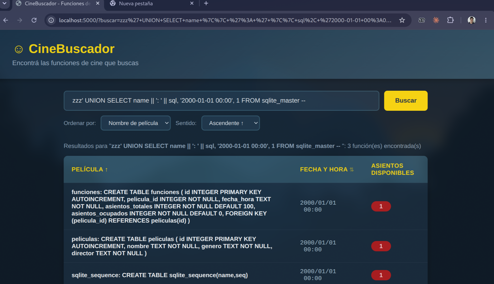

### 3. Impacto comprobado

La prueba con la comilla simple permite demostrar rápidamente que la entrada del usuario altera la sintaxis SQL. Por su parte, el `UNION SELECT` evidencia un impacto mayor: permite recuperar columnas y metadatos que la interfaz de la aplicación no debería exponer.

### 4. Mitigación aplicada

La corrección aplicada en `buscar_funciones` consistió en eliminar la concatenación directa de la entrada del usuario, utilizar una consulta parametrizada y agregar una lista de valores permitidos (*whitelist*) para `sort_dir`:

```python
def buscar_funciones(query, sort_by='nombre', sort_dir='ASC'):
    db = get_db()
    columna_orden = 'peliculas.nombre' if sort_by == 'nombre' else 'funciones.fecha_hora'
    direccion = 'DESC' if sort_dir == 'DESC' else 'ASC'
    sql = "SELECT peliculas.nombre as pelicula, funciones.fecha_hora, " \
          "(funciones.asientos_totales - funciones.asientos_ocupados) as disponibles " \
          "FROM funciones " \
          "JOIN peliculas ON funciones.pelicula_id = peliculas.id " \
          "WHERE peliculas.nombre LIKE ? " \
          f"ORDER BY {columna_orden} {direccion}"
    return db.execute(sql, (f'%{query}%',)).fetchall()
```

La modificación principal que corrige la vulnerabilidad consiste en cambiar `LIKE '%{query}%'` por `LIKE ?` y pasar el valor aparte, en `db.execute(sql, (f'%{query}%',))`. De esta forma, `query` deja de concatenarse con la sentencia SQL y se transmite como un valor independiente. SQLite lo interpreta como dato y no como parte ejecutable de la consulta. En consecuencia, caracteres especiales o expresiones como `UNION SELECT` dejan de modificar la estructura de la sentencia. La separación entre consulta y datos evita que la entrada controlada por el usuario altere el SQL.

Otro punto identificado durante la revisión fue `sort_dir`, que también se concatenaba directamente al final del `ORDER BY`. Este comportamiento fue identificado durante una segunda revisión del código. En el caso de `ORDER BY`, no es posible parametrizar el identificador mediante `?` — en esa posición no se espera un valor, sino un identificador o una palabra clave, por lo que el placeholder no resulta aplicable.

Por este motivo, la mitigación utilizada fue una lista de valores permitidos (*whitelist*). Si `sort_dir` no es exactamente `'DESC'`, se usa `'ASC'` independientemente del valor enviado por el usuario. Como prueba, envié `sort_dir="ASC; DROP TABLE peliculas--"` y fue normalizado a `ASC`, sin producir efectos adicionales. `sort_by` no requirió cambios, ya que su lógica ya restringía correctamente los valores posibles: la expresión condicional únicamente puede devolver dos nombres de columna predefinidos, y no permitía introducir identificadores arbitrarios.

### 5. Verificación posterior

Después de aplicar el cambio, repetí las mismas pruebas para comprobar que la vulnerabilidad hubiera sido mitigada sin afectar el funcionamiento legítimo de la aplicación: la búsqueda normal (`buscar=Dune`) continúa devolviendo las mismas tres funciones que antes. El payload `Dune'` ya no genera un error: se interpreta literalmente como texto y no altera la sintaxis SQL. Del mismo modo, el `UNION SELECT ... FROM peliculas` devuelve 0 filas, ya que toda la cadena se procesa como un valor de búsqueda dentro de `nombre` y no como parte de la consulta. Con estas pruebas confirmé que la corrección bloquea la inyección sin alterar el comportamiento esperado de la búsqueda.

## Ejercicio 2 — Cross-Site Scripting (XSS)

### 1. Identificación de la vulnerabilidad

Este ejercicio utiliza la misma base de CineBuscador que el ejercicio anterior, incorporando una nueva funcionalidad para editar una película desde `/edit/<id>`. Al revisar `Ejercicio2/app.py`, observé que el endpoint no exige autenticación y permite enviar una solicitud `POST` para modificar nombre, género, director y descripción de cualquier película.

Como primera etapa, revisé `Ejercicio2/templates/edit.html` para verificar cómo se renderizaba el campo de descripción. Allí encontré lo siguiente en la línea 86:

```html
<strong>Descripción actual:</strong><br>
{{ pelicula['descripcion'] | safe }}
```

El punto crítico es el uso del filtro `| safe`: Flask por defecto escapa automáticamente cualquier contenido incluido dentro de `{{ }}` en un template (convierte `<`, `>`, comillas, etc. en entidades HTML), así que normalmente si se almacena `<script>` como contenido textual, se muestra como texto y no se ejecuta. El filtro `safe` indica a Jinja que el contenido debe considerarse seguro y no debe escaparse, y como se aplicaba directamente a un campo que el usuario llena en un formulario (`descripcion`), un usuario puede almacenar contenido HTML o JavaScript sin escapar, el cual queda persistido en la base de datos y puede ejecutarse cuando se carga posteriormente la página de edición. Este comportamiento corresponde a un XSS almacenado.

Como comparación, en `templates/index.html` (donde también se muestra la descripción, en la tabla de resultados) no usan `| safe`, allí el comportamiento es correcto — por lo que el payload se muestra como texto plano en lugar de ejecutarse (esto lo confirmé después, en la PoC). La vulnerabilidad se concentra específicamente en esa línea 86 de `edit.html`.

### 2. Proceso de comprobación (PoC)

Como paso previo, inicié el contenedor correspondiente a este ejercicio. Como el puerto 5000 ya lo tenía ocupado el contenedor del Ejercicio 1, este quedó mapeado al puerto 5002 (`docker compose up -d --build` desde `Ejercicio2/`, con el contenedor escuchando en `localhost:5002`).

#### Prueba preliminar — Identificación del punto de entrada correcto

En una primera prueba introduje el payload en un punto incorrecto: el buscador de la página principal, en el campo `buscar`. La aplicación devolvió:

```
OperationalError
sqlite3.OperationalError: near "XSS": syntax error
```

La causa del error fue identificada inmediatamente: el buscador de este ejercicio usa la misma función `buscar_funciones` sin parametrizar que ya habíamos visto en el Ejercicio 1 (por lo que este ejercicio también conserva la vulnerabilidad SQLi observada anteriormente), y el payload contenía una comilla simple (`'XSS - '`), que altera la consulta del mismo modo observado previamente con `Dune'`. Esta prueba permitió distinguir ambos puntos de entrada: el buscador presenta SQLi, mientras que el XSS se encuentra en el formulario de edición.

Una vez identificado correctamente el punto vulnerable, realicé la prueba sobre el formulario de edición:

#### Paso 1 — Acceso al punto vulnerable

Ingresé directamente a `http://localhost:5002/edit/1`.

#### Paso 2 — Almacenamiento del payload

En el campo **Descripción** introduje:

```
   <script>alert('XSS - ' + document.cookie)</script>
```
#### Paso 3 — Guardado de los datos

Dejé los demás campos (nombre, género, director) con sus valores originales y seleccioné **Guardar cambios**. La acción envía un `POST` a `/edit/1`, que almacena los datos con una consulta parametrizada (`UPDATE ... SET descripcion=?`), por lo que el payload se almacena sin errores, como cualquier otro valor de texto.

#### Paso 4 — Comprobación del almacenamiento

Volví al buscador (`/?buscar=dune`) para verificar cómo se había almacenado el dato, y allí observé que el payload se mostraba literalmente como texto (`<script>alert('XSS - ' + document.cookie)</script>`), sin ejecutarse:

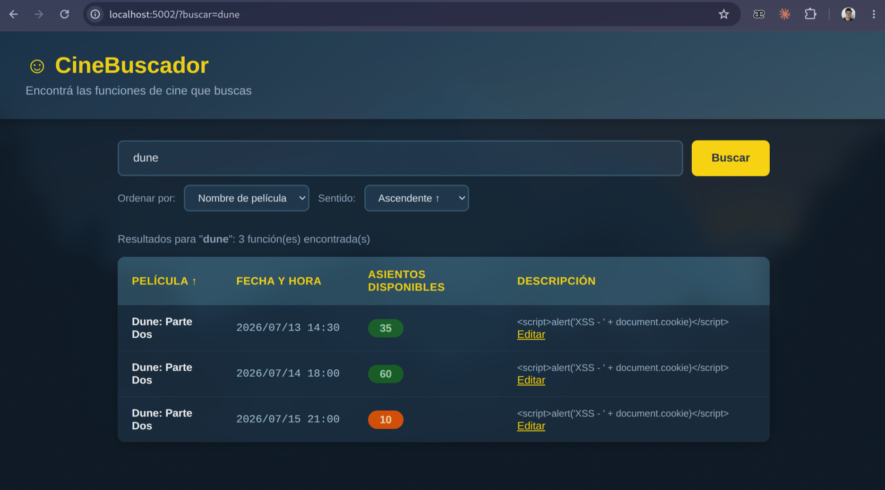

Esto coincide con el comportamiento observado en el código: `index.html` sí escapa bien el campo, por lo que el payload no se ejecuta en esa vista.

#### Paso 5 — Ejecución en la vista vulnerable

Como paso final, accedí nuevamente a `http://localhost:5002/edit/1`. En el cuadro "Descripción actual" —el que usa el `| safe`— el script se ejecutó y produjo la alerta JavaScript:

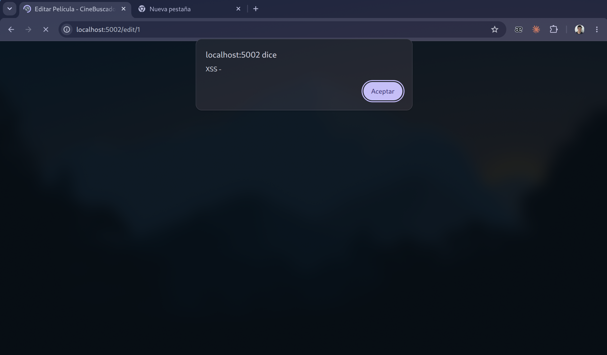

### 3. Impacto comprobado

La prueba demostró que el payload queda almacenado en la base de datos y se ejecuta cada vez que se carga la página de edición de la película. Esto corresponde a un **XSS almacenado**, ya que el contenido malicioso persiste y puede afectar a cualquier usuario que visite posteriormente la vista vulnerable, sin necesidad de utilizar un enlace especialmente preparado.

### 4. Mitigación aplicada

La corrección consistió en eliminar el filtro `| safe` de `edit.html`.

```html
<!-- antes -->
{{ pelicula['descripcion'] | safe }}
<!-- después -->
{{ pelicula['descripcion'] }}
```

Al eliminar `| safe`, ese `{{ }}` vuelve a pasar por el auto-escape que Jinja ya tiene activado por defecto en Flask. De esta forma, si `descripcion` contiene `<script>...</script>`, se convierte en `&lt;script&gt;...&lt;/script&gt;` antes de enviarse al navegador, y el navegador lo muestra como texto en vez de interpretarlo como una etiqueta HTML. Para este caso no fue necesario incorporar una sanitización manual adicional: el mecanismo de autoescape de Jinja resulta suficiente una vez eliminado `| safe`, que era el elemento que deshabilitaba dicho escape.

### 5. Verificación posterior

Para verificar la corrección, reconstruí el contenedor y repetí la misma prueba: envié nuevamente el `POST` a `/edit/1` con el mismo payload (`<script>alert('XSS - ' + document.cookie)</script>`) y después hice `GET` a `/edit/1`. El HTML que devolvió esta vez fue:

```
<strong>Descripción actual:</strong><br>
&lt;script&gt;alert(&#39;XSS - &#39; + document.cookie)&lt;/script&gt;
```

El resultado ya no contiene una etiqueta `<script>` ejecutable, sino texto escapado — el navegador no la ejecuta, se muestra como texto literal. El campo `textarea` de más abajo (que ya usaba `{{ pelicula['descripcion'] }}` sin `safe` desde antes)

continuó funcionando normalmente, lo que permitió confirmar que la corrección no afectó el flujo legítimo del formulario.

**Observación:** este ejercicio conserva el mismo SQLi del Ejercicio 1 sin corregir (mismo `buscar_funciones` con la consulta armada por f-string). No se modificó en esta sección porque no constituye el objetivo específico del ejercicio.

## Ejercicio 3 — Carga insegura de archivos (File Upload)

### 1. Identificación de la vulnerabilidad

A diferencia de los ejercicios anteriores, esta implementación utiliza Java con Spring Boot. La aplicación conserva el concepto de CineBuscador e incorpora una funcionalidad para cargar un afiche asociado a cada película desde `/upload/<id>`.

Como primera etapa, revisé `Ejercicio3/src/main/java/com/cinebuscador/controller/PeliculaController.java` para analizar cómo se gestionaba la carga de archivos, y encontré en el método `uploadFile` antes de realizar modificaciones:

```java
@PostMapping("/upload/{id}")
public String uploadFile(@PathVariable Integer id,
                         @RequestParam("afiche") MultipartFile archivo) throws IOException {
    Pelicula pelicula = peliculaRepo.findById(id)
        .orElseThrow(() -> new EntityNotFoundException("Pelicula no encontrada"));
    String filename = archivo.getOriginalFilename();
    Path uploadPath = Paths.get(uploadDir);
    if (!Files.exists(uploadPath)) {
        Files.createDirectories(uploadPath);
    }
    Files.copy(archivo.getInputStream(), uploadPath.resolve(filename));
    pelicula.setAfichePath(filename);
    peliculaRepo.save(pelicula);
    return "redirect:/";
}
```

El código no implementa validaciones ni de extensión, ni de content-type, ni del nombre del archivo. El formulario (`upload.html`) tampoco restringe los tipos de archivo en el lado del cliente — el campo de carga utiliza `accept="*/*"`, por lo que permite seleccionar cualquier tipo de archivo.

Posteriormente, revisé el endpoint que entrega nuevamente los archivos cargados (`serveFile`, un poco más abajo en el mismo controller):

```java
@GetMapping("/uploads/{filename:.+}")
@ResponseBody
public ResponseEntity<Resource> serveFile(@PathVariable String filename) throws IOException {
    Path filePath = Paths.get(uploadDir).resolve(filename).normalize();
    Resource resource = new UrlResource(filePath.toUri());
    MediaType mediaType = MediaTypeFactory.getMediaType(resource)
        .orElse(MediaType.APPLICATION_OCTET_STREAM);
    ...
    return ResponseEntity.ok()
        .contentType(mediaType)
        .header(HttpHeaders.CONTENT_DISPOSITION, "inline; filename=\"" + resource.getFilename() + "\"")
        .body(resource);
}
```

En este punto identifiqué un segundo aspecto relevante: `MediaTypeFactory.getMediaType` determina el tipo de contenido según la **extensión** del archivo y lo entrega con `Content-Disposition: inline`. Por lo tanto, si se carga un `.html`, el servidor lo devuelve con `Content-Type: text/html` e `inline`, y el navegador puede renderizarlo como una página HTML normal en lugar de tratarlo como un archivo para descargar. La combinación de ambos comportamientos —aceptar cualquier tipo de archivo y servirlo con un `Content-Type` determinado por su extensión— hace que la funcionalidad de carga de afiches permita alojar y ejecutar contenido HTML/JavaScript controlado por el usuario en el dominio de la aplicación.

### 2. Proceso de comprobación (PoC)

Inicié el contenedor correspondiente a este ejercicio (`docker compose up -d --build` dentro de `Ejercicio3/`, queda en `http://localhost:8080/`, es una aplicación Spring Boot con base H2). A continuación, realicé tres pruebas en orden incremental:

#### Paso 1 — Carga de un archivo de control (PDF)

Ingresé al buscador, seleccioné la película "The Matrix", accedí a **Subir afiche** y cargué un PDF —el mismo archivo utilizado en la consigna del práctico— en lugar de una imagen. La aplicación lo aceptó sin generar ninguna validación o rechazo — ni el formulario ni el backend verifican que el archivo corresponda realmente a una imagen.

#### Paso 2 — Carga de un archivo HTML con JavaScript

Repetí el mismo flujo desde la interfaz —buscar la película y seleccionar **Subir afiche**—, pero esta vez elegí un archivo `xss_poc.html` (que contenía un `<script>alert(...)</script>`) en el selector de archivos:

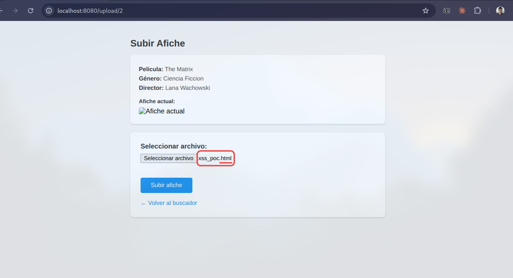

El archivo también fue almacenado sin restricciones, y la aplicación redirigió al buscador como si se tratara de un afiche válido.

#### Paso 3 — Acceso directo a los archivos cargados

Dado que el afiche se representa dentro de una etiqueta ``, y ni el PDF ni el HTML son imágenes válidas, en la tarjeta de la película se muestra el ícono de imagen rota. Mediante clic derecho sobre ese ícono y eligiendo "Abrir imagen en una pestaña nueva", el navegador navega directamente a la URL de `/uploads/<archivo>` como si fuera una página; en ese punto se observa la diferencia de comportamiento:

- Al abrir el PDF, se abre una pestaña nueva mostrando el contenido real del PDF (el navegador lo reconoce por el `Content-Type` que le envía el servidor y lo renderiza con su visor de PDF integrado):

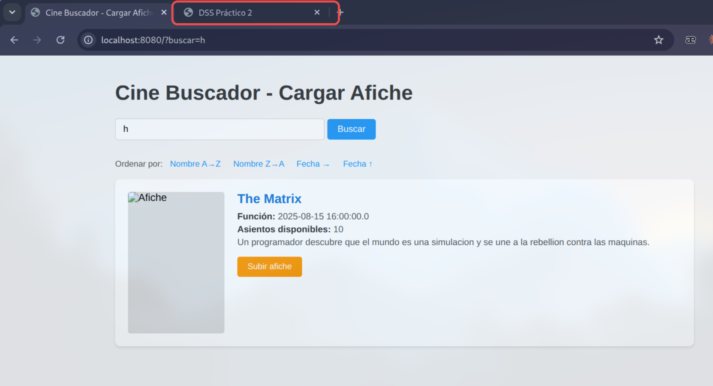

- Al abrir el HTML, en cambio, el navegador ya no lo trata como una imagen rota: lo carga como documento HTML completo, y el `<script>` que tenía adentro se ejecuta al cargar el documento:

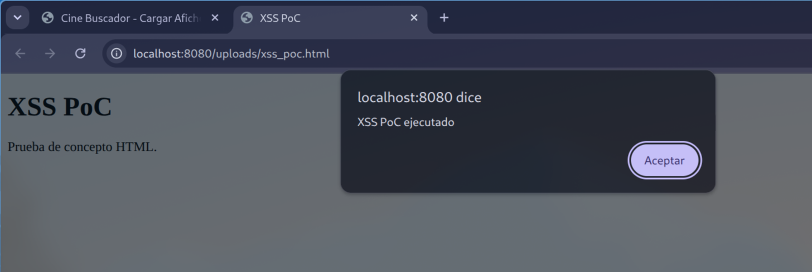

### 3. Impacto comprobado

La prueba con el PDF permitió comprobar que la aplicación aceptaba archivos ajenos al tipo esperado. La prueba con HTML confirmó el impacto de seguridad: un usuario podía alojar contenido HTML/JavaScript mediante la funcionalidad destinada a afiches y lograr que dicho contenido se ejecutara bajo el origen de la aplicación al acceder directamente al archivo.

Durante la misma revisión identifiqué además un problema relacionado: `Files.copy(archivo.getInputStream(), uploadPath.resolve(filename))` utiliza el nombre de archivo proporcionado por el cliente sin sanitización. Para comprobarlo, realicé una prueba con `curl` (esta manipulación no puede reproducirse únicamente desde el selector estándar del navegador, ya que este no permite definir manualmente un nombre con `../`) enviando un archivo con el nombre `../../../../tmp/evil.png`, y confirmé que terminaba almacenado en `/tmp/evil.png` dentro del contenedor, fuera de la carpeta de uploads ; esto evidencia un *path traversal* durante la escritura. Esta prueba se realizó por línea de comandos y no cuenta con captura, pero se documenta porque la mitigación aplicada también corrige este comportamiento.

### 4. Mitigación aplicada

La corrección aplicada en `uploadFile` consistió en incorporar una lista de extensiones permitidas (*whitelist*) y dejar de utilizar directamente el nombre proporcionado por el cliente, generando en su lugar un nombre controlado por el servidor:

```java
private static final Set<String> EXTENSIONES_PERMITIDAS = Set.of(".jpg", ".jpeg", ".png", ".gif", ".webp");
@PostMapping("/upload/{id}")
public String uploadFile(@PathVariable Integer id,
                         @RequestParam("afiche") MultipartFile archivo) throws IOException {
    Pelicula pelicula = peliculaRepo.findById(id)
        .orElseThrow(() -> new EntityNotFoundException("Pelicula no encontrada"));
    String originalFilename = archivo.getOriginalFilename();
    String extension = (originalFilename != null && originalFilename.contains("."))
        ? originalFilename.substring(originalFilename.lastIndexOf('.')).toLowerCase()
        : "";
    if (!EXTENSIONES_PERMITIDAS.contains(extension)) {
        throw new IllegalArgumentException("Solo se permiten imagenes (jpg, jpeg, png, gif, webp)");
    }
    String filename = "afiche_" + id + "_" + System.currentTimeMillis() + extension;
    Path uploadPath = Paths.get(uploadDir);
    if (!Files.exists(uploadPath)) {
        Files.createDirectories(uploadPath);
    }
    Files.copy(archivo.getInputStream(), uploadPath.resolve(filename));
    pelicula.setAfichePath(filename);
    peliculaRepo.save(pelicula);
    return "redirect:/";
}
```

La modificación mitiga ambos problemas de forma simultánea:

- La lista `EXTENSIONES_PERMITIDAS` impide la carga de cualquier archivo cuya extensión no se encuentre expresamente permitida — un `.html`, `.svg` o cualquier otro formato ejecutable se rechaza antes de almacenar el archivo, por lo que se evita alojar contenido HTML/JavaScript arbitrario a través del "afiche".

- El nombre de archivo final (`afiche_<id>_<timestamp><extensión>`) lo genera el servidor, no el cliente. La única parte obtenida del nombre original es la extensión, extraída mediante `lastIndexOf('.')`. Por lo tanto, aunque el nombre completo contenga `../../../../tmp/evil.png`, el único componente utilizado es `.png`. Como el nombre ya no tiene ningún fragmento controlado por el atacante, el path traversal en la escritura queda mitigado como consecuencia del mismo cambio, sin necesidad de agregar validaciones específicas sobre secuencias de ruta.

### 5. Verificación posterior

Para verificar la corrección, reconstruí el contenedor y repetí las mismas pruebas con `curl`:

- La carga del mismo archivo `.html` con el script devolvió un error 500 (por la excepción no gestionada; aunque la respuesta no es la ideal, la carga es rechazada), y solicitar posteriormente `/uploads/xss_poc2.html` dio **404** — el archivo no llegó a almacenarse.

- Al cargar una imagen real utilizando el nombre de traversal (`../../../../tmp/evil.png`) quedó almacenada como `afiche_3_<timestamp>.png` **dentro** de `/uploads`, y verifiqué que no se creó ningún archivo en `/tmp` del contenedor — la corrección también mitigó el path traversal.

### 6. Observaciones y mejoras adicionales

Como mejora adicional, sería conveniente devolver un error controlado en lugar del 500 genérico de Spring (agregando un `@ExceptionHandler`), También sería recomendable validar el contenido real del archivo (los primeros bytes / "magic numbers") en vez de confiar solo en la extensión, ya que un archivo malicioso podría renombrarse un archivo malicioso para que termine en `.png` a pesar de no serlo. Para el alcance del ejercicio, la lista de extensiones permitidas junto con la generación del nombre en el servidor impide las pruebas realizadas.

## Ejercicio 4 — Server-Side Template Injection (SSTI)

### 1. Identificación de la vulnerabilidad

Este ejercicio utiliza nuevamente Spring Boot, en una aplicación de menor tamaño: un buscador de funciones con un solo campo de búsqueda. Durante la revisión inicial del proyecto identifiqué un elemento que requería especial atención: había un archivo llamado `SpelEvaluator.java` en `config/`, un componente inusual para la lógica esperada de un buscador convencional.

Al revisar su contenido encontré lo siguiente (`Ejercicio4/src/main/java/com/cinebuscador/config/SpelEvaluator.java`):

```java
public String evaluate(String expression) {
    if (expression == null || expression.isBlank()) {
        return "";
    }
    ExpressionParser parser = new SpelExpressionParser();
    org.springframework.expression.EvaluationContext context =
        SimpleEvaluationContext.forReadOnlyDataBinding().build();
    StandardEvaluationContext standardContext = new StandardEvaluationContext();
    standardContext.setVariable("system", System.class);
    standardContext.setVariable("runtime", Runtime.class);
    var expr = parser.parseExpression(expression);
    Object result = expr.getValue(standardContext);
    return result != null ? result.toString() : "";
}
```

Este método interpreta el valor recibido en `expression` como una expresión de **SpEL** (Spring Expression Language, el lenguaje utilizado por Spring en expresiones como `@Value("#{...}")`) y posteriormente **la evalúa**. El aspecto crítico es que el método crea un `SimpleEvaluationContext` (la variante "segura", de solo lectura, que en teoría es para este tipo de casos) pero posteriormente no lo utiliza: la evaluación real (`expr.getValue(standardContext)`) se realiza utilizando un `StandardEvaluationContext`, un contexto con capacidades considerablemente más amplias — permite invocar métodos, usar `T(...)` para referenciar cualquier clase estática de Java, e instanciar objetos con `new`. Adicionalmente, se exponen variables `#system` y `#runtime` referenciando directamente `System.class` y `Runtime.class`.

Posteriormente, busqué dónde se invocaba `evaluate(...)` y, en `Ejercicio4/src/main/java/com/cinebuscador/controller/FuncionController.java`, encontré la siguiente llamada dentro del método `search`:

```java
String spelResultado = spelEval.evaluate(buscar);
```
`buscar` es el parámetro de la URL que llena el campo de búsqueda ("Buscar función..."). Esto implica que **la entrada introducida en el buscador se evalúa como una expresión SpEL en el servidor**. El comportamiento corresponde a una SSTI basada en SpEL y, debido a las capacidades del contexto utilizado, puede escalar hasta ejecución de comandos del sistema operativo (RCE).

El propio ejercicio confirma además que este comportamiento fue incorporado con fines educativos: la página contiene una advertencia que dice *"Ejercicio educativo: la búsqueda incluye una vulnerabilidad de SSTI (SpEL injection)"* — la advertencia forma parte explícita del escenario del práctico.

### 2. Proceso de comprobación (PoC)

Inicié el contenedor (`docker compose up -d --build` en `Ejercicio4/`, queda en `http://localhost:8080/`) y realicé pruebas progresivas directamente sobre el campo de búsqueda, comenzando por expresiones de bajo impacto y avanzando gradualmente.

#### Paso 1 — Confirmación de la evaluación de expresiones SpEL

Introduje la expresión:

```
1+1
```

En lugar de buscar la película "1+1" (que lógicamente no existe), el mensaje de resultados dice:

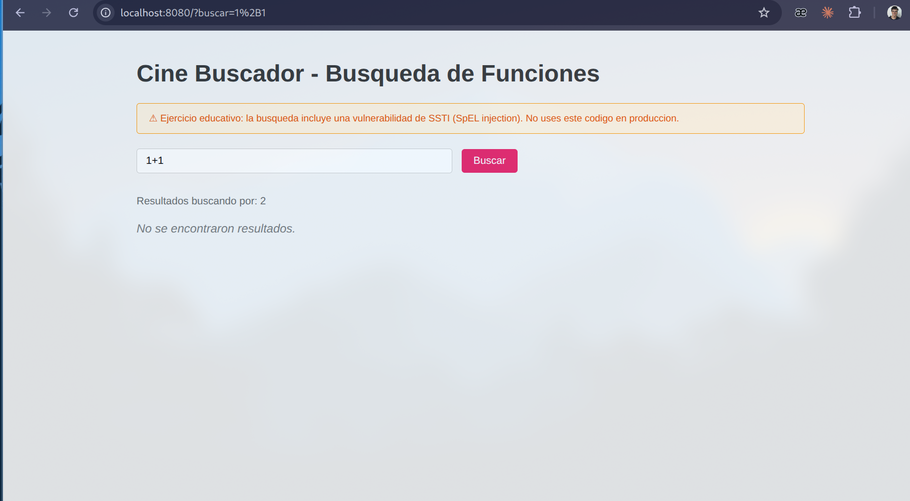

`Resultados buscando por: 2`. Este resultado confirmó que la aplicación estaba evaluando aritméticamente la entrada en lugar de tratarla como texto; un buscador convencional no debería transformar "1+1" en "2".

#### Paso 2 — Acceso a información del servidor mediante SpEL

Con `T(...)` se puede referenciar cualquier clase de Java y llamar sus métodos estáticos. Utilicé la siguiente expresión:

```
T(java.lang.System).getProperty('user.name')
```

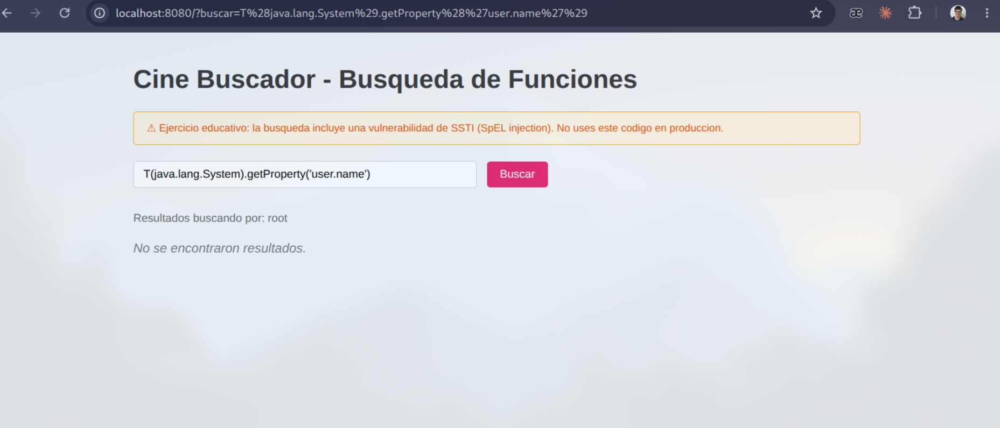

El resultado fue `root`, correspondiente al usuario bajo el cual se ejecuta el proceso Java dentro del contenedor. Esto confirmó que la expresión podía acceder a clases y métodos de Java, superando ampliamente una simple evaluación matemática.

#### Paso 3 — Ejecución de un comando del sistema operativo

La siguiente prueba consistió en utilizar `Runtime.exec`:

```
T(java.lang.Runtime).getRuntime().exec(new String[]{'/bin/sh','-c','id > /tmp/spel_pwned.txt'})
```

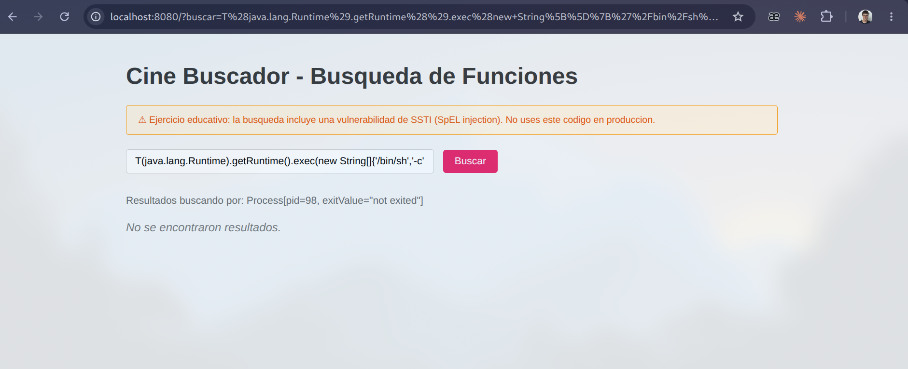

En este caso, la página no muestra la salida del comando directamente — únicamente el `toString()` del objeto `Process` (`Process[pid=98, exitValue="not exited"]`) — pero el objeto devuelto permite comprobar que el proceso fue iniciado. (Nota: al intentar encadenar `.getInputStream()` para leer la salida en la misma expresión, se produce un error 500; hay una restricción de los módulos de Java (JPMS) que bloquea el acceso mediante reflection a esa clase interna en particular. Esta limitación afecta únicamente la forma de recuperar la salida y no la ejecución del comando.)

#### Paso 4 — Recuperación de la salida del comando

Dado que el paso anterior almacenó la salida en `/tmp/spel_pwned.txt`, la recuperé mediante una API de Java que no tiene el problema de reflection del paso anterior:

```
T(java.nio.file.Files).readString(T(java.nio.file.Paths).get('/tmp/spel_pwned.txt'))
```

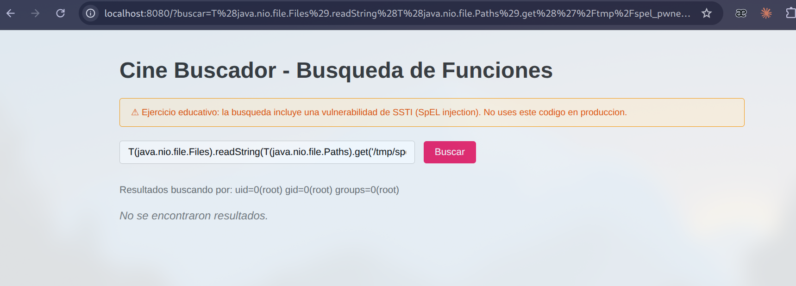

`Resultados buscando por: uid=0(root) gid=0(root) groups=0(root)` — la salida real de un comando de sistema operativo, ejecutado en el servidor a través del buscador de películas, y mostrada de vuelta en la misma página.

### 3. Impacto comprobado

La secuencia de pruebas confirmó la posibilidad de **ejecución remota de comandos (RCE)**: la entrada controlada desde el buscador podía evaluarse como una expresión SpEL, invocar APIs de Java, ejecutar un comando del sistema operativo y recuperar posteriormente su resultado. Todo el proceso se realizó desde la propia interfaz web del ejercicio.

### 4. Mitigación aplicada

Al revisar nuevamente el código, observé que el proyecto ya contenía parcialmente la alternativa adecuada: el método crea un `SimpleEvaluationContext` (línea con `context = SimpleEvaluationContext...`)

que corresponde a la variante restringida de SpEL. Sin embargo, la expresión se evaluaba contra `standardContext` (`StandardEvaluationContext`, sin restricciones) en lugar de utilizar el `context` restringido ya creado. La corrección mínima consistió en utilizar el contexto restringido ya disponible, y eliminar el contexto innecesariamente permisivo:

```java
public String evaluate(String expression) {
    if (expression == null || expression.isBlank()) {
        return "";
    }
    ExpressionParser parser = new SpelExpressionParser();
    org.springframework.expression.EvaluationContext context =
        SimpleEvaluationContext.forReadOnlyDataBinding().build();
    var expr = parser.parseExpression(expression);
    Object result = expr.getValue(context);
    return result != null ? result.toString() : "";
}
```

Eliminé el `StandardEvaluationContext`, las dos líneas que exponían `#system`/`#runtime`, y cambié `expr.getValue(standardContext)` por `expr.getValue(context)`.

Esta modificación mitiga la vulnerabilidad porque `SimpleEvaluationContext` no permite referencias a tipos (`T(...)`), ni `new` para instanciar objetos, ni referencias a beans — está pensado específicamente para evaluar expresiones simples (lectura de propiedades) sin otorgar a la entrada evaluada acceso a la API completa de Java. Dado que el ataque depende de la posibilidad de utilizar `T(java.lang.Runtime)...`, eliminar esa capacidad del contexto de evaluación impide la explotación sin depender de filtros manuales de palabras clave.

### 5. Verificación posterior

Para verificar la corrección, reconstruí el contenedor y repetí las pruebas:

- `buscar='Inception'` y `buscar=1+1` continúan funcionando como antes (`Resultados buscando por: Inception` / `: 2`) — esas expresiones no necesitan `T(...)` ni capacidades bloqueadas por el contexto restringido, por lo que el comportamiento previsto del ejercicio se conserva.

- El mismo payload del Paso 2 (`T(java.lang.System).getProperty('user.name')`) ahora devuelve un error 500. Al revisar el log del contenedor, el error es `SpelEvaluationException: EL1005E: Type cannot be found 'java.lang.System'` — lo que confirma que `SimpleEvaluationContext` no puede resolver `java.lang.System`, no puede resolver referencias a tipos.

- El payload de RCE completo del Paso 3 (`Runtime.getRuntime().exec(...)`) también devuelve un error 500 por el mismo motivo, y verifiqué en el contenedor que el archivo `/tmp/should_not_exist.txt` no se creó — el comando no se ejecutó.

### 6. Observaciones y mejoras adicionales

Como mejora adicional, convendría evitar un 500 genérico ante una expresión inválida (agregar un `@ExceptionHandler` con un mensaje tipo "búsqueda inválida"), y evaluar si resulta necesario utilizar SpEL para esta funcionalidad — un buscador de texto no necesita evaluar expresiones, ni siquiera con el contexto restringido. Dado que el ejercicio está orientado a demostrar el riesgo de utilizar un contexto de evaluación excesivamente permisivo, la corrección mínima aplicada consiste en utilizar el `EvaluationContext` restringido en lugar del contexto con capacidades amplias.

## Ejercicio 5 — Almacenamiento inseguro de contraseñas

### 1. Proceso de identificación

Este ejercicio utiliza una aplicación Spring Boot centrada en autenticación, con un formulario de "Iniciar Sesión" y otro de "Registrarse" (`Ejercicio5/src/main/java/com/cinebuscador/controller/AuthController.java`).

Como primera prueba, registré un usuario con la contraseña `1`. Después de iniciar sesión observé un comportamiento inesperado: la página, debajo del mensaje de bienvenida, tiene una caja que dice **"Password cifrada"** y muestra una cadena codificada en Base64 (`aAOVLfrU6aBI8G6GZ00IRQ==`):

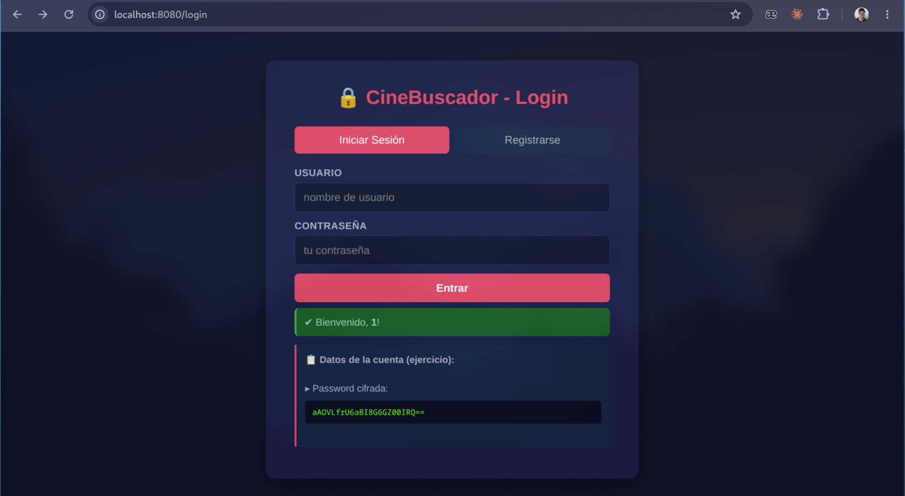

Este comportamiento resultó llamativo: desde el punto de vista de diseño, no existe una necesidad funcional evidente de mostrar al usuario un valor derivado de su propia contraseña. Además, el formato observado motivó la revisión del mecanismo de almacenamiento. La exposición explícita de ese valor llevó a considerar la posibilidad de que se tratara de un mecanismo de cifrado reversible.

#### Paso 1 — Comprobación de comportamiento determinístico

La primera hipótesis fue la siguiente: si el mecanismo utiliza cifrado simétrico sin componentes aleatorios (sin salt, sin IV), dos usuarios con la misma contraseña deberían producir el mismo valor "cifrado". Registré dos cuentas nuevas, `u1` y `u2`, con exactamente la misma contraseña, y comparé el valor mostrado por la interfaz al iniciar sesión con cada una:

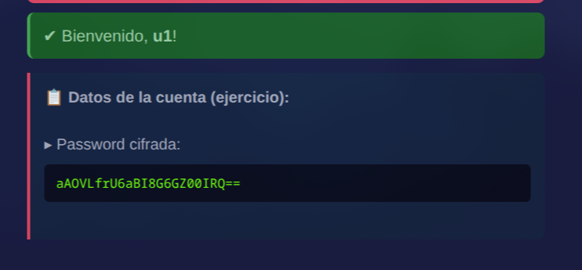

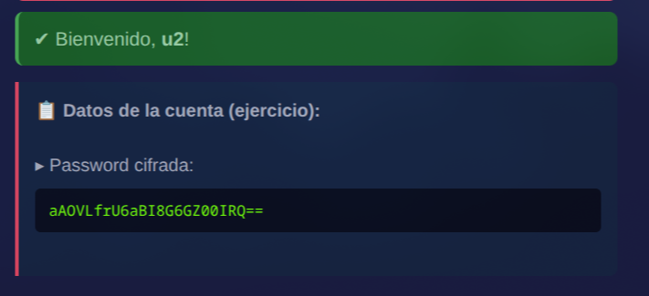

Ambos valores resultaron **idénticos**. Esto confirmó que es un cifrado sin aleatoriedad, lo que representa un problema de seguridad (una persona con acceso a la base puede identificar qué usuarios comparten contraseña sin necesidad de descifrarla), pero el siguiente objetivo fue determinar si la contraseña original podía recuperarse.

#### Paso 2 — Revisión del mecanismo de cifrado

Revisé el código fuente para identificar cómo se implementaba el cifrado y, en `Ejercicio5/src/main/java/com/cinebuscador/config/EncryptionService.java`, encontré la clave de cifrado **definida directamente en el código fuente**:

```java
private static final String SECRET_KEY = "MySup3rS3cr3tK3y!2024CineBuscadorAES";
...
private static final String CIPHER_ALGO = "AES/ECB/PKCS5Padding";
```

El código confirmó dos aspectos relevantes: es AES en modo **ECB** (lo que explica que el mismo texto plano produzca siempre el mismo resultado cifrado, sin importar el usuario), y la clave no está en ningún secret manager ni en una variable de entorno — se encuentra definida de forma estática, en el `.java`. Por lo tanto, una persona con acceso al código fuente o al `.jar` podría obtener la clave utilizada para descifrar las contraseñas almacenadas.

#### Paso 3 — Comprobación de reversibilidad

Con la clave identificada, utilicé **CyberChef** (`gchq.github.io/CyberChef`, se ejecuta en el navegador) para descifrar el valor capturado anteriormente.

Preparé la clave en hexadecimal a partir del string de la clase (truncada a los 32 bytes que exige AES-256) y apliqué `From Base64` + `AES Decrypt` (modo ECB) sobre el ciphertext:

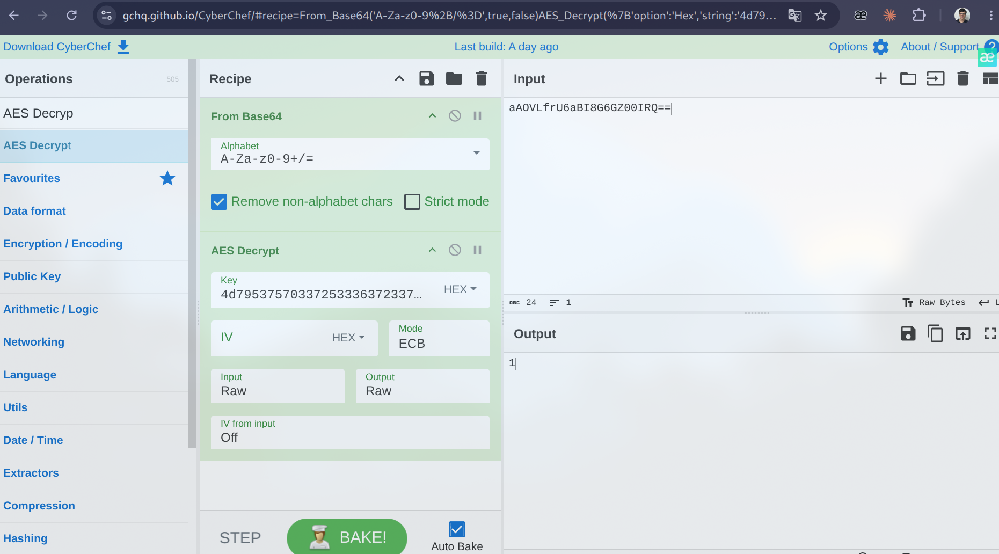

El resultado obtenido fue `1` — exactamente la contraseña utilizada durante el registro. La prueba confirmó que el mecanismo de almacenamiento era reversible para quien dispusiera de la clave.

#### Paso 4 — Validación en el cliente

Durante las pruebas identifiqué una segunda debilidad: el formulario de registro aceptó `1` como contraseña, es decir, un único carácter, sin generar ningún rechazo. Esto llevó a sospechar que la única restricción presente en el formulario era el atributo `required` del HTML (que solo exige que el campo no esté vacío en el navegador), y que el backend podía carecer de una validación equivalente. Para comprobar esta hipótesis necesitaba enviar una solicitud HTTP directamente al backend, sin depender de las restricciones del formulario. Para formular el comando de prueba realicé una consulta puntual a una herramienta de inteligencia artificial, a partir de la cual utilicé el siguiente comando `curl` para intentar registrar un usuario con la contraseña **vacía**:

```bash
curl -X POST http://localhost:8080/register \
  --data-urlencode "username=vacio" \
  --data-urlencode "password=" \
  --data-urlencode "confirmPwd="
```

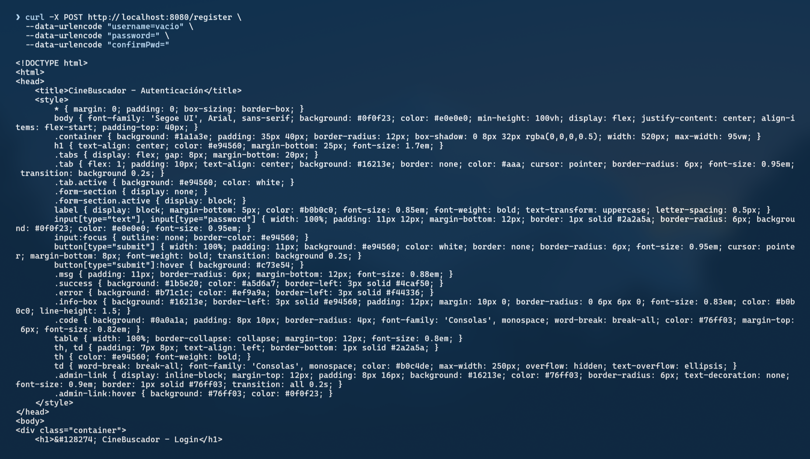

El servidor respondió con la página de éxito y no generó ningún error. Esto confirmó que el backend registraba igualmente al usuario, incluso con una contraseña vacía, porque la única comprobación que existía era la del atributo `required` en el HTML — una restricción que puede omitirse enviando directamente la solicitud HTTP al backend.

### 2. Vulnerabilidades identificadas

1. **Contraseñas almacenadas mediante cifrado reversible en lugar de hash**, con AES-256 en modo **ECB** y una **clave definida de forma estática en el código fuente** (`EncryptionService.java`). Una persona con acceso al código (repositorio expuesto, `.jar` descompilado, persona con acceso previo al código) podría descifrar las contraseñas almacenadas, porque la clave nunca cambia. Además, al no usar un IV/salt (por el modo ECB), dos usuarios con la misma contraseña generan el mismo valor cifrado, revelando esa coincidencia sin ni siquiera descifrar nada.

2. **Validación de contraseña solo en el cliente.** El backend (`AuthController.register`) no comprobaba longitud mínima ni que la contraseña no estuviera vacía — toda la restricción vivía en el atributo `required` del formulario HTML, que no constituye una protección efectiva frente a solicitudes enviadas directamente al backend.

### 3. Mitigación aplicada

Apliqué dos correcciones específicas, una para cada vulnerabilidad identificada, procurando modificar únicamente lo necesario.

#### 3.1. Sustitución del cifrado reversible por BCrypt

Incorporé la dependencia `spring-security-crypto` (que incorpora los codificadores de contraseñas sin requerir la configuración completa de Spring Security) y reescribí `EncryptionService`:

```java
public class EncryptionService {
    private static final BCryptPasswordEncoder ENCODER = new BCryptPasswordEncoder();
    public static String hash(String plaintext) {
        return ENCODER.encode(plaintext);
    }
    public static boolean matches(String plaintext, String hash) {
        return ENCODER.matches(plaintext, hash);
    }
}
```

Eliminé la clave estática, el modo ECB, y los métodos que exponían la clave (`getStaticKey`, `getKeyHex`, `getKeyBytes`) — con este enfoque deja de existir una clave de descifrado, porque BCrypt no cifra: genera un hash con un **salt aleatorio distinto en cada llamada**, y ese hash no se puede revertir a la contraseña original aunque se disponga del código fuente completo. En `AuthController` cambié `encrypt`/`decrypt` por `hash`/`matches` en `register` y `login`.

#### 3.2. Incorporación de validación en el servidor

En `AuthController.register`, antes de continuar con el proceso de registro:

```java
if (password == null || password.isBlank() || password.length() < 4) {
    model.addAttribute("registerError", "La contraseña debe tener al menos 4 caracteres");
    addForms(model);
    return "index";
}
```

La validación se realiza ahora en el backend, por lo que también se aplica cuando una solicitud se envía directamente a `/register` con `curl` o Postman sin utilizar el formulario del navegador.

### 4. Verificación posterior

Reconstruí el contenedor y repetí las mismas pruebas utilizadas durante la etapa de identificación:

- El mismo `curl` con `password=` vacío que anteriormente era aceptado, ahora devuelve el error `"La contraseña debe tener al menos 4 caracteres"` y no crea el usuario.

- Un registro normal con una contraseña válida sigue funcionando de forma equivalente al comportamiento anterior (`"creado"`), por lo que el flujo legítimo se mantuvo operativo.

- Registré dos usuarios nuevos con la **misma** contraseña (`SamePass1`) y esta vez el hash asociado a cada uno es **distinto** para cada uno (`$2a$10$F2Xx...` vs `$2a$10$z.Ni...`) — el salt aleatorio de BCrypt evita también la identificación directa de contraseñas repetidas, como consecuencia del uso de valores salt aleatorios.

- El login con la contraseña correcta continúa siendo validado correctamente (comparé `EncryptionService.matches(...)` contra el hash guardado), por lo que el mecanismo de autenticación conserva su funcionamiento esperado.

- Intentar aplicar la misma receta de CyberChef (AES/ECB + la clave vieja) contra uno de los hashes nuevos ya no resulta aplicable: el valor guardado ya no es un Base64 de AES, es un hash BCrypt (`$2a$10$...`), un formato completamente distinto que no puede descifrarse de forma reversible, ni con la clave vieja ni con ninguna otra.

### 5. Observaciones y mejoras adicionales

Como mejora adicional, incorporar un límite de intentos de inicio de sesión (fuerza bruta) y evitar mostrar al usuario ningún dato relacionado a su propia contraseña en pantalla (ni siquiera un hash) — aunque con BCrypt ya no sea explotable como antes, continúa siendo una práctica innecesaria desde el punto de vista de diseño y seguridad. Las dos modificaciones aplicadas resuelven los problemas principales identificados: el almacenamiento reversible de contraseñas y la ausencia de validación efectiva en el backend.

---

## Nota sobre el uso de inteligencia artificial

Se utiliza inteligencia artificial como herramienta de apoyo para modificar el Markdown y darle una mejor estructura, así como para mejorar la redacción y mantener un formato uniforme. También se utiliza para realizar consultas puntuales sobre comandos, sintaxis y metodologías empleadas durante el desarrollo del práctico.
