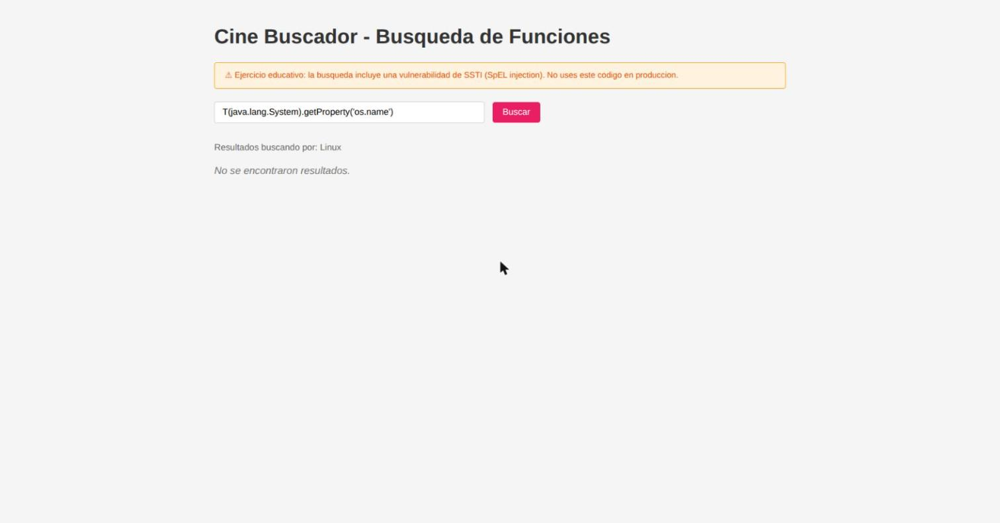
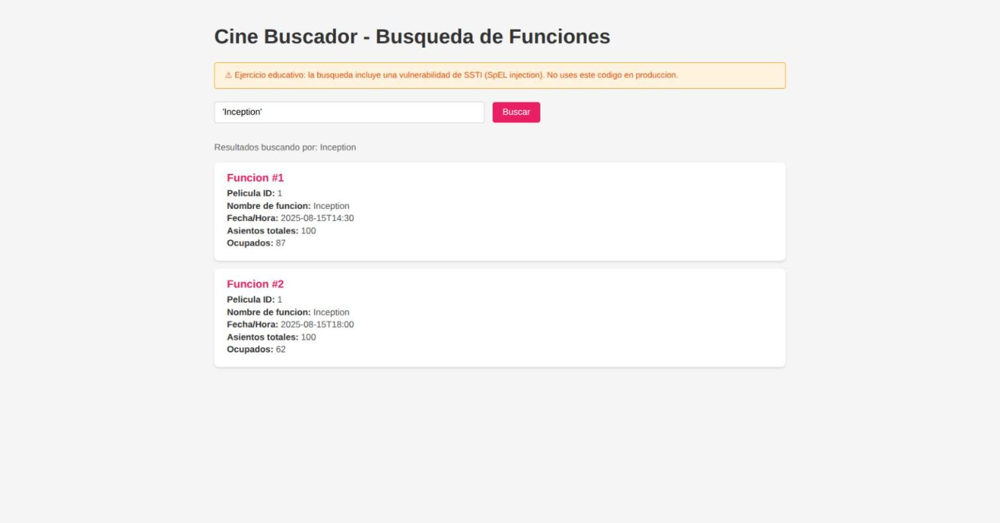

# Práctico 4 — Desarrollo Seguro de Software

**Universidad Católica del Uruguay**
**Estudiante:** Axel Hernández

---

## Introducción

En este práctico escribí pruebas automáticas para las cinco vulnerabilidades que ya había mitigado en el Práctico 2. La idea del práctico es que estas pruebas queden en el repositorio y corran en cada liberación: si alguien reintroduce la vulnerabilidad, la prueba la tiene que volver a detectar. Por eso el mismo conjunto de tests vive igual en las dos ramas (`main`, con el código vulnerable, y `practico-2`, con las mitigaciones) y la única diferencia es el resultado: en `main` fallan las aserciones que detectan el comportamiento inseguro, y en `practico-2` pasan todas.

Lo cuento ejercicio por ejercicio como fui trabajándolo: qué quería comprobar, qué hace la prueba, qué observé al correrla en cada rama y qué quedó como evidencia. Separo siempre lo que **observé** (el resultado real de una corrida) de lo que **infiero** (por ejemplo, que un HTML sin escapar se ejecutaría en el navegador). Para cada ejercicio uso la tecnología que pide la consigna: Pytest para las unitarias de E1 y E2, pruebas de integración por HTTP sobre el contenedor Docker para E3 y E4, y JUnit para E5. Mantuve el conjunto en exactamente esas cinco pruebas, sin agregar grupos extra, para que cada test apunte a una mitigación concreta y sea fácil de leer.

Antes de empezar tuve que resolver un tema de numeración que arrastraba del Práctico 2. La consigna del Práctico 4 ubica el SSTI en el «ejercicio3» y el RCE en el «ejercicio4», pero en el repositorio (y en mi informe del Práctico 2) la carpeta [`Ejercicio3`](../../Ejercicio3) es la de carga insegura de archivos y la evaluación de expresiones SpEL —la que corresponde a SSTI y RCE— está en [`Ejercicio4`](../../Ejercicio4). Lo dejo anotado acá porque es una discrepancia real del material, no algo que yo pueda decidir por mi cuenta; más abajo explico cómo lo resolví sin inventar una vulnerabilidad nueva. El SSTI y el RCE los probé sobre el flujo SpEL real de [`Ejercicio4`](../../Ejercicio4); la carga de archivos de [`Ejercicio3`](../../Ejercicio3) queda fuera de los cinco ejercicios pedidos, así que no le agregué una prueba automática en este práctico.

Una aclaración importante sobre el alcance: las pruebas verifican las mitigaciones **tal como las entregué en el Práctico 2**, sin modificarlas. No cambié el código de la aplicación para que las pruebas pasaran; al revés, escribí cada prueba para comprobar exactamente lo que la mitigación del Práctico 2 ya hacía. La única diferencia de código de aplicación respecto del Práctico 2 es un par de métodos auxiliares en `main` para E5, que explico en esa sección.

El detalle de cada corrida (rama, commit, comando y código de salida) está en el [registro de evidencias](evidencias/README.md).

### Mapa de archivos de prueba

| Ejercicio | Tipo | Archivo de prueba | Código bajo prueba |
|---|---|---|---|
| E1 — SQLi | Unitaria (Pytest) | [`tests/practico4/test_e1_sqli_unit.py`](../../tests/practico4/test_e1_sqli_unit.py) | [`Ejercicio1/app.py`](../../Ejercicio1/app.py) |
| E2 — XSS | Unitaria (Pytest) | [`tests/practico4/test_e2_xss_unit.py`](../../tests/practico4/test_e2_xss_unit.py) | [`Ejercicio2/templates/edit.html`](../../Ejercicio2/templates/edit.html) |
| E3 — SSTI | Integración (Pytest+Docker) | [`tests/practico4/test_e3_ssti.py`](../../tests/practico4/test_e3_ssti.py) | [`Ejercicio4/.../FuncionController.java`](../../Ejercicio4/src/main/java/com/cinebuscador/controller/FuncionController.java) |
| E4 — RCE | Integración (Pytest+Docker) | [`tests/practico4/test_e4_rce.py`](../../tests/practico4/test_e4_rce.py) | [`Ejercicio4/.../FuncionController.java`](../../Ejercicio4/src/main/java/com/cinebuscador/controller/FuncionController.java) |
| E5 — Almacenamiento | Unitaria (JUnit) | [`Ejercicio5/.../EncryptionServiceTest.java`](../../Ejercicio5/src/test/java/com/cinebuscador/config/EncryptionServiceTest.java) | [`Ejercicio5/.../EncryptionService.java`](../../Ejercicio5/src/main/java/com/cinebuscador/config/EncryptionService.java) |

> En cada ejercicio incluyo los fragmentos mínimos del código real para ver la vulnerabilidad, su mitigación y las aserciones de la prueba. Los enlaces son relativos, así que abren el archivo **en la rama que esté viendo el lector**; por eso rotulo cada bloque con la rama a la que pertenece el código que muestra. Los tests son iguales en las dos ramas.

---

## E1 — Inyección SQL (prueba unitaria, Pytest)

**Qué quería comprobar.** Que el texto que escribe el usuario en el buscador no se incorpore a la sintaxis del SQL, sino que viaje como un dato aparte.

**Qué revisé.** La unidad es la función `buscar_funciones` de [`Ejercicio1/app.py`](../../Ejercicio1/app.py). En `main` el término se concatena dentro del SQL con un f-string (`LIKE '%{query}%'`), y además `sort_dir` se pega directo al `ORDER BY`. En `practico-2` el término pasa como parámetro de `execute` (`LIKE ?`) y `sort_dir` se normaliza con una lista blanca.

**La prueba.** [`tests/practico4/test_e1_sqli_unit.py`](../../tests/practico4/test_e1_sqli_unit.py) llama directamente a `buscar_funciones`. Para no depender de un servidor ni de la base del proyecto, creo una base SQLite en memoria dentro del propio test y reemplazo únicamente `get_db`; la función real sigue armando y ejecutando la consulta. Son tres casos: una búsqueda normal (`Dune` devuelve solo Dune), el payload `%' OR 1=1 -- ` (que en la versión vulnerable hace volver todas las películas) y un `sort_dir` con `ASC LIMIT 0` (que si se concatenara al `ORDER BY` dejaría la búsqueda vacía). Elegí comprobar el comportamiento real contra una base —no la forma de la llamada— para que el test detecte una regresión y no solo un cambio de sintaxis.

**Qué observé.** En `main`, el `OR 1=1` trae Dune y Oppenheimer y el `sort_dir` deja la búsqueda en cero: fallan esas dos aserciones. En `practico-2`, los tres casos pasan: el payload se interpreta como texto y el `ORDER BY` ignora el valor inyectado. El caso normal pasa en las dos ramas.

**Fragmentos de código.**

`main` — [`Ejercicio1/app.py`](../../Ejercicio1/app.py), función `buscar_funciones`. El término `query` y `sort_dir` se concatenan en el SQL con un f-string:

```python
def buscar_funciones(query, sort_by='nombre', sort_dir='ASC'):
    db = get_db()
    sql = f"SELECT peliculas.nombre as pelicula, funciones.fecha_hora, " \
          f"(funciones.asientos_totales - funciones.asientos_ocupados) as disponibles " \
          f"FROM funciones " \
          f"JOIN peliculas ON funciones.pelicula_id = peliculas.id " \
          f"WHERE peliculas.nombre LIKE '%{query}%' " \
          f"ORDER BY {'peliculas.nombre' if sort_by == 'nombre' else 'funciones.fecha_hora'} " \
          f"{sort_dir}"
    return db.execute(sql).fetchall()
```

`practico-2` — [`Ejercicio1/app.py`](../../Ejercicio1/app.py), misma función. El término va como parámetro (`LIKE ?`) y `sort_dir` se normaliza con una lista blanca antes de llegar al `ORDER BY`:

```python
def buscar_funciones(query, sort_by='nombre', sort_dir='ASC'):
    db = get_db()
    columna_orden = 'peliculas.nombre' if sort_by == 'nombre' else 'funciones.fecha_hora'
    direccion = 'DESC' if sort_dir == 'DESC' else 'ASC'
    sql = "SELECT peliculas.nombre as pelicula, funciones.fecha_hora, " \
          "(funciones.asientos_totales - funciones.asientos_ocupados) as disponibles " \
          "FROM funciones " \
          "JOIN peliculas ON funciones.pelicula_id = peliculas.id " \
          "WHERE peliculas.nombre LIKE ? " \
          f"ORDER BY {columna_orden} {direccion}"
    return db.execute(sql, (f'%{query}%',)).fetchall()
```

Prueba — [`tests/practico4/test_e1_sqli_unit.py`](../../tests/practico4/test_e1_sqli_unit.py) (igual en las dos ramas). Un fixture inyecta una base en memoria reemplazando `get_db`, y cada test llama a la función real:

```python
def test_busqueda_normal(buscar):
    assert nombres(buscar("Dune")) == ["Dune"]


def test_comilla_en_buscar_no_altera_la_consulta(buscar):
    assert nombres(buscar("%' OR 1=1 -- ")) == []


def test_sentido_de_orden_no_altera_la_consulta(buscar):
    assert nombres(buscar("Dune", sort_dir="ASC LIMIT 0")) == ["Dune"]
```

El caso normal exige que `Dune` devuelva solo `Dune`; el del `OR 1=1`, que el payload no traiga todas las películas; el del `sort_dir`, que un `LIMIT 0` inyectado no vacíe el resultado.

**Evidencia.** El resultado de la corrida está en los logs [`E1-sqli/main/02-pytest.log`](evidencias/E1-sqli/main/02-pytest.log) y [`E1-sqli/practico-2/02-pytest.log`](evidencias/E1-sqli/practico-2/02-pytest.log).

**Aprendizaje.** Al principio armé el test con un doble que devolvía filas fijas, y me di cuenta de que así el caso normal pasaba sí o sí, sin tocar la consulta real: no probaba nada. Lo rehíce contra una base SQLite en memoria para que [`buscar_funciones`](../../Ejercicio1/app.py) arme y ejecute el SQL de verdad. Con eso el caso normal (`Dune`) confirma que la búsqueda sigue andando, y los dos casos de seguridad (`OR 1=1` y el `sort_dir`) me hicieron ver que había **dos** puntos de inyección, no solo el obvio. Entendí que una unitaria tiene que ejercitar la lógica real, no la forma de la llamada.

---

## E2 — Cross-Site Scripting (prueba unitaria, Pytest)

**Qué quería comprobar.** Que la descripción de una película se escape en el bloque de vista previa donde se muestra.

**Qué revisé.** La unidad es la plantilla [`Ejercicio2/templates/edit.html`](../../Ejercicio2/templates/edit.html). En `main` la vista previa usa `{{ pelicula['descripcion'] | safe }}`, y ese `| safe` desactiva el autoescape de Jinja. En `practico-2` se quitó el filtro, así que vuelve a aplicar el escape por defecto.

**La prueba.** [`tests/practico4/test_e2_xss_unit.py`](../../tests/practico4/test_e2_xss_unit.py) renderiza la plantilla con la misma llamada que hace la aplicación (`render_template`, dentro de un `test_request_context`), sin base de datos ni servidor. Con el payload `<script>alert('xss')</script>` corto el bloque `.prev-descripcion` y compruebo dos cosas: que el `<script>` sin escapar **no** aparece y que sí aparece el texto escapado `&lt;script&gt;`. Un segundo caso comprueba que una descripción normal se sigue viendo. Usé `render_template` a propósito, porque si armara el entorno Jinja a mano podría habilitar un escape que la app real no use, y entonces el test probaría otra cosa.

**Qué observé.** En `main` el `<script>` aparece sin escapar en la vista previa: falla esa aserción. En `practico-2` queda como `&lt;script&gt;`, texto que el navegador no ejecuta. El caso de la descripción normal pasa en las dos ramas.

**Observado vs. inferido.** Observé el HTML escapado o sin escapar; que el HTML sin escapar se ejecutaría en el navegador es una inferencia a partir del contexto de salida. No abrí un navegador en el test.

**Fragmentos de código.**

`main` — [`Ejercicio2/templates/edit.html`](../../Ejercicio2/templates/edit.html), bloque de vista previa. El filtro `| safe` desactiva el autoescape de Jinja:

```html
<div class="prev-descripcion">
    <strong>Descripción actual:</strong><br>
    {{ pelicula['descripcion'] | safe }}
</div>
```

`practico-2` — [`Ejercicio2/templates/edit.html`](../../Ejercicio2/templates/edit.html), mismo bloque sin `| safe`, así que vuelve a aplicar el escape por defecto:

```html
<div class="prev-descripcion">
    <strong>Descripción actual:</strong><br>
    {{ pelicula['descripcion'] }}
</div>
```

Prueba — [`tests/practico4/test_e2_xss_unit.py`](../../tests/practico4/test_e2_xss_unit.py) (igual en las dos ramas). Renderiza la plantilla real y mira el bloque de vista previa:

```python
def test_descripcion_con_script_se_escapa(modulo_ejercicio2):
    bloque = vista_previa(modulo_ejercicio2, "<script>alert('xss')</script>")

    assert "<script>" not in bloque
    assert "&lt;script&gt;" in bloque
```

La aserción pide que el `<script>` crudo no aparezca y que sí aparezca su forma escapada `&lt;script&gt;`.

**Evidencia.** El resultado de la corrida está en los logs [`E2-xss/main/02-pytest.log`](evidencias/E2-xss/main/02-pytest.log) y [`E2-xss/practico-2/02-pytest.log`](evidencias/E2-xss/practico-2/02-pytest.log).

**Aprendizaje.** Mi primera versión preparaba el entorno Jinja a mano y comparaba varios payloads, y me di cuenta de que así corría el riesgo de activar un escape que la app real no usa —estaría probando otra cosa—. Lo simplifiqué para renderizar [`edit.html`](../../Ejercicio2/templates/edit.html) con el mismo `render_template` de producción y un solo `<script>` con aserciones explícitas. El caso normal confirma que el escape no rompe una descripción legítima, y el del `<script>` confirma que el `| safe` es lo que marca la diferencia. Entendí que el test tiene que reproducir el contexto de salida real, y que un payload claro alcanza cuando el escape es a nivel de carácter.

---

## E3 — SSTI / inyección de expresiones SpEL (integración, Pytest sobre Docker)

**Qué quería comprobar.** Que la entrada del buscador no se evalúe como una expresión en el servidor.

**La discrepancia de numeración.** La consigna pide un SSTI en el «ejercicio3». Al revisar el repositorio, la carpeta [`Ejercicio3`](../../Ejercicio3) es un gestor de pósters con carga de archivos: no renderiza entrada del usuario en una plantilla, usa vistas fijas y `th:text` escapado, así que no hay SSTI ahí. La vulnerabilidad que el material rotula como SSTI está en [`Ejercicio4`](../../Ejercicio4): la ruta `/` recibe `buscar` y lo pasaba a un `SpelEvaluator` que lo evaluaba como expresión **SpEL** (Spring Expression Language). La propia página lo dice —tiene un cartel que avisa «vulnerabilidad de SSTI (SpEL injection)»— y en mi informe del Práctico 2 lo documenté como Ejercicio 4. Técnicamente esto es inyección de expresiones (SpEL), no inyección en un motor de plantillas; el material docente lo llama SSTI y mantengo esa terminología, pero dejo la aclaración anotada porque la numeración del enunciado no coincide con la del repositorio. No inventé una aplicación nueva ni moví la vulnerabilidad: probé el flujo real que existe.

**La mitigación del Práctico 2.** La mitigación que entregué en el Práctico 2 vive en [`Ejercicio4/.../SpelEvaluator.java`](../../Ejercicio4/src/main/java/com/cinebuscador/config/SpelEvaluator.java): evalúa la expresión con un `SimpleEvaluationContext.forReadOnlyDataBinding()`. Ese contexto es la variante restringida de SpEL: permite literales, operadores y acceso a propiedades, pero **no** permite referencias a tipos con `T(...)`, ni `new`, ni invocar métodos arbitrarios —que son las capacidades que llevan de SSTI a RCE—. En `main`, en cambio, el mismo [`SpelEvaluator.java`](../../Ejercicio4/src/main/java/com/cinebuscador/config/SpelEvaluator.java) usa un `StandardEvaluationContext` sin restricciones y expone `#system`/`#runtime`. Dejé esta mitigación **tal como la entregué en el Práctico 2**, sin tocarla, y escribí la prueba para comprobar lo que esa mitigación realmente bloquea.

**La prueba.** [`tests/practico4/test_e3_ssti.py`](../../tests/practico4/test_e3_ssti.py) hace peticiones HTTP a la aplicación Java levantada en Docker ([`Ejercicio4/docker-compose.yml`](../../Ejercicio4/docker-compose.yml), contenedor `cinebuscador4`). Comprueba tres cosas: que la búsqueda normal `'Inception'` funciona; que `T(java.lang.System).getProperty('os.name')` no devuelve el nombre del sistema operativo; y que `T(java.lang.Runtime)` no resuelve la clase `Runtime`. Las dos últimas son los vectores peligrosos del SSTI/SpEL (acceso a tipos de Java), que es justo lo que `SimpleEvaluationContext` bloquea. **No** compruebo que `1+1` deje de dar `2`: el contexto restringido del Práctico 2 evalúa aritmética de forma legítima y eso, por sí solo, no es el vector de inyección —exigir bloquearlo pediría una mitigación distinta de la entregada—.

**Qué observé.** Lo probé a mano con `curl` y con el navegador contra el contenedor. En `main`, `T(java.lang.System).getProperty('os.name')` devuelve «Resultados buscando por: Linux» (filtró el nombre del SO) y `T(java.lang.Runtime)` devuelve «… class java.lang.Runtime»: los tipos se resuelven. En `practico-2`, los dos vectores producen un error HTTP 500 (`SimpleEvaluationContext` rechaza la referencia al tipo), así que no se filtra nada. En la corrida de pytest, `main` falla las dos aserciones de seguridad y pasa la búsqueda normal; `practico-2` pasa las tres.

**Qué demuestra y sus límites.** La prueba demuestra que el vector explotable del SSTI —resolver tipos de Java para leer datos del servidor o llegar a `Runtime`— se evalúa en `main` y queda bloqueado en `practico-2`. No recorre todas las expresiones posibles, solo dos vectores representativos. Y «bloqueado» en `practico-2` se manifiesta como un HTTP 500: la mitigación **rechaza** la expresión peligrosa (no la ejecuta), aunque lo hace con un error genérico en vez de tratarla como texto. Eso previene la inyección; que además evalúe aritmética inocua o devuelva 500 en lugar de un mensaje amable es una observación de robustez, no una vía de explotación abierta.

**Fragmentos de código.**

`main` — [`Ejercicio4/.../SpelEvaluator.java`](../../Ejercicio4/src/main/java/com/cinebuscador/config/SpelEvaluator.java), método `evaluate`. Crea un `SimpleEvaluationContext` restringido pero **evalúa con un `StandardEvaluationContext`** sin límites, al que además le expone `#system` y `#runtime`:

```java
public String evaluate(String expression) {
    if (expression == null || expression.isBlank()) {
        return "";
    }

    ExpressionParser parser = new SpelExpressionParser();

    org.springframework.expression.EvaluationContext context =
        SimpleEvaluationContext.forReadOnlyDataBinding().build();

    StandardEvaluationContext standardContext = new StandardEvaluationContext();

    standardContext.setVariable("system", System.class);
    standardContext.setVariable("runtime", Runtime.class);

    var expr = parser.parseExpression(expression);
    Object result = expr.getValue(standardContext);

    return result != null ? result.toString() : "";
}
```

`practico-2` — [`Ejercicio4/.../SpelEvaluator.java`](../../Ejercicio4/src/main/java/com/cinebuscador/config/SpelEvaluator.java), mismo método. Evalúa contra el `context` restringido, que no resuelve `T(...)` ni expone clases:

```java
public String evaluate(String expression) {
    if (expression == null || expression.isBlank()) {
        return "";
    }

    ExpressionParser parser = new SpelExpressionParser();

    org.springframework.expression.EvaluationContext context =
        SimpleEvaluationContext.forReadOnlyDataBinding().build();

    var expr = parser.parseExpression(expression);
    Object result = expr.getValue(context);

    return result != null ? result.toString() : "";
}
```

Prueba — [`tests/practico4/test_e3_ssti.py`](../../tests/practico4/test_e3_ssti.py) (igual en las dos ramas). El helper `buscar` captura también el 500 que devuelve la mitigación, y cada aserción comprueba que un tipo de Java no se resolvió:

```python
def test_no_resuelve_tipos_java_del_sistema():
    _, pagina = buscar("T(java.lang.System).getProperty('os.name')")
    assert "Resultados buscando por: Linux" not in pagina


def test_no_referencia_la_clase_runtime():
    _, pagina = buscar("T(java.lang.Runtime)")
    assert "class java.lang.Runtime" not in pagina
```


*E3-01 — `main`: con `buscar=T(java.lang.System).getProperty('os.name')`, la aplicación responde «Resultados buscando por: **Linux**». La expresión se evaluó y filtró el nombre del sistema operativo del servidor. Captura: [`evidencias/E3-ssti/main/01-ssti-navegador.png`](evidencias/E3-ssti/main/01-ssti-navegador.png).*


*E3-02 — `practico-2`: la búsqueda normal `'Inception'` devuelve sus dos funciones. Lo incluyo para mostrar que la aplicación responde con normalidad en esta rama; así el error de la siguiente captura se entiende como el rechazo de un payload concreto y no como una app caída. Captura: [`evidencias/E3-ssti/practico-2/02-busqueda-normal.png`](evidencias/E3-ssti/practico-2/02-busqueda-normal.png).*


*E3-03 — `practico-2`: con la app funcionando (E3-02), el mismo payload `T(java.lang.System)...` de E3-01 devuelve un **error 500** (`SimpleEvaluationContext` no resuelve `T(...)`), sin filtrar nada. Captura: [`evidencias/E3-ssti/practico-2/01-ssti-navegador.png`](evidencias/E3-ssti/practico-2/01-ssti-navegador.png). La prueba de mitigación no es el 500 por sí solo, sino el contraste entre las tres capturas —`main` filtra «Linux», `practico-2` responde normal pero rechaza el payload— más las aserciones de los logs de integración [`E3-ssti/main/02-integracion.log`](evidencias/E3-ssti/main/02-integracion.log) y [`E3-ssti/practico-2/02-integracion.log`](evidencias/E3-ssti/practico-2/02-integracion.log), que verifican que el nombre del sistema no aparece.*

**Aprendizaje.** Al principio había puesto una aserción que exigía que `1+1` dejara de dar `2`, y me di cuenta de que eso pedía una mitigación más estricta que la que entregué en el Práctico 2: terminaba cambiando la app para que el test pasara. Reorienté la prueba hacia los vectores que de verdad importan —`T(java.lang.System)` y `T(java.lang.Runtime)`—, que son los que [`SimpleEvaluationContext`](../../Ejercicio4/src/main/java/com/cinebuscador/config/SpelEvaluator.java) bloquea. También corregí una aserción que pasaba en `main` por un detalle de texto y no por un bloqueo real. El caso normal confirma que la búsqueda anda; los de tipos, que el camino de inyección queda cerrado. Entendí que debía validar la mitigación existente, no acomodar la app al test.

---

## E4 — Remote Code Execution (integración, Pytest sobre Docker)

**Qué quería comprobar.** Que esa misma entrada no pueda ejecutar un comando del sistema operativo en el servidor, sin correr yo nada destructivo.

**La prueba.** [`tests/practico4/test_e4_rce.py`](../../tests/practico4/test_e4_rce.py) envía por HTTP una expresión SpEL que intenta ejecutar `touch` sobre un archivo con nombre aleatorio en `/tmp` dentro del contenedor (`Runtime.getRuntime().exec(['touch', marcador])`), el mismo tipo de payload de `Runtime.exec` que usé como PoC en el Práctico 2. Después consulto si el archivo existe con `docker exec` y lo borro en el `finally`, pase lo que pase. Antes de dar un veredicto, el test comprueba que puede entrar al contenedor: si no pudiera, «el archivo no existe» no probaría nada, así que en ese caso la prueba falla con un mensaje claro en vez de dar un falso positivo. El caso normal busca `'Inception'` por el mismo flujo.

**Qué observé.** En `main`, el archivo aparece en el contenedor: la expresión ejecutó un comando del SO, así que falla la aserción de seguridad; la búsqueda normal pasa. En `practico-2`, el archivo no se crea (la expresión devuelve 500 antes de ejecutar nada) y la búsqueda normal pasa.

**Cómo separo E3 de E4.** E3 y E4 recorren el mismo controlador [`Ejercicio4/.../FuncionController.java`](../../Ejercicio4/src/main/java/com/cinebuscador/controller/FuncionController.java), que usa el evaluador [`Ejercicio4/.../SpelEvaluator.java`](../../Ejercicio4/src/main/java/com/cinebuscador/config/SpelEvaluator.java), pero cada prueba mira una cosa distinta: E3, que la entrada resuelva tipos de Java (el acceso que filtra datos); E4, el efecto concreto de ejecutar un comando y dejar un archivo. Son objetivos separados aunque la aplicación sea la misma.

**Fragmentos de código.** El código vulnerable es el mismo [`Ejercicio4/.../SpelEvaluator.java`](../../Ejercicio4/src/main/java/com/cinebuscador/config/SpelEvaluator.java) ya mostrado en E3 (en `main` evalúa con `StandardEvaluationContext`, en `practico-2` con el restringido), así que no lo repito. Lo propio de E4 es el payload de ejecución del test.

Prueba — [`tests/practico4/test_e4_rce.py`](../../tests/practico4/test_e4_rce.py) (igual en las dos ramas). Envía una expresión que intenta ejecutar `touch`, confirma primero que puede entrar al contenedor y después comprueba que el archivo **no** se creó:

```python
def test_busqueda_no_ejecuta_comandos():
    # Sin acceso al contenedor, "el archivo no existe" no probaría nada.
    assert en_contenedor("true").returncode == 0, f"No se pudo entrar a {CONTENEDOR}"

    marcador = f"/tmp/practico4-rce-{uuid.uuid4().hex}"
    comando = (
        "T(java.lang.Runtime).getRuntime()"
        f".exec(new String[]{{'touch','{marcador}'}})"
    )
    try:
        buscar(comando).read()
        for _ in range(10):
            if existe(marcador):
                break
            time.sleep(0.3)

        assert not existe(marcador), "La búsqueda ejecutó un comando en el servidor"
    finally:
        en_contenedor("rm", "-f", marcador)
```

**Evidencia.** Los logs [`E4-rce/main/02-integracion.log`](evidencias/E4-rce/main/02-integracion.log) y [`E4-rce/practico-2/02-integracion.log`](evidencias/E4-rce/practico-2/02-integracion.log) guardan la corrida completa.

**Aprendizaje.** La primera versión consultaba el archivo con `docker exec` y daba por buena la ausencia del archivo, pero me di cuenta de que si no lograba entrar al contenedor el test también «pasaba», confundiendo un error de acceso con una mitigación. Por eso [`test_e4_rce.py`](../../tests/practico4/test_e4_rce.py) ahora comprueba primero que puede entrar al contenedor y recién entonces juzga, y uso `touch` como comando real en vez de una escritura de Java. El caso normal confirma el flujo de búsqueda; el de `exec`, que ninguna expresión deja un archivo. Al revisar el resultado entendí que un fallo de infraestructura nunca debe disfrazarse de prueba de seguridad aprobada.

---

## E5 — Almacenamiento inseguro de contraseñas (prueba unitaria, JUnit)

**Qué quería comprobar.** Que la contraseña se pueda verificar sin guardarla en claro y que lo almacenado sea un hash de contraseña con salt, no cualquier transformación reversible que simplemente produzca un texto distinto.

**Qué revisé.** En [`Ejercicio5/.../EncryptionService.java`](../../Ejercicio5/src/main/java/com/cinebuscador/config/EncryptionService.java), `main` usa AES/ECB con una clave fija y tiene método de descifrado; `practico-2` usa BCrypt y `matches`.

**La única diferencia de código de aplicación respecto del Práctico 2.** La consigna pide que *el mismo conjunto de comprobaciones* exista en las dos ramas. El test llama a `EncryptionService.hash(...)` y `EncryptionService.matches(...)`, que son la API de la mitigación de `practico-2`. En `main` esos métodos no existen (la API vulnerable es `encrypt`/`decrypt`), así que el mismo test no compilaría. Para que compile, en `main` agregué dos métodos auxiliares `hash`/`matches` que simplemente envuelven el `encrypt`/`decrypt` AES que ya estaba; **no cambian el comportamiento vulnerable** (el almacenamiento sigue siendo AES/ECB reversible y determinístico) y el propio código lo aclara en un comentario. Lo evalué: la alternativa de llamar a los métodos por reflexión fallaría en `main` con un `NoSuchMethodException`, que es un error de carga, no una aserción de seguridad —justo lo que hay que evitar—. Por eso el adaptador es la adaptación mínima imprescindible para correr una unitaria idéntica en ambas ramas, y la prueba igual falla en `main` por el comportamiento inseguro, no por el adaptador.

**La prueba.** [`Ejercicio5/.../EncryptionServiceTest.java`](../../Ejercicio5/src/test/java/com/cinebuscador/config/EncryptionServiceTest.java) invoca el servicio real, sin levantar Spring ni Docker. Son tres tests: que una clave correcta coincide y una incorrecta no (y que el valor guardado no contiene la contraseña en claro); que la misma contraseña, guardada dos veces, da valores distintos (con AES/ECB y clave fija darían iguales); y que el valor guardado tiene el formato estándar de BCrypt con un costo de al menos 10. Puse el formato porque la sola desigualdad aceptaría un cifrado reversible con relleno aleatorio: es lo que distingue un hash de contraseña de un AES cualquiera.

**Qué observé.** En `main` fallan la desigualdad (AES/ECB es determinístico, los dos valores salen iguales) y el formato BCrypt; pasa la verificación, porque el adaptador sobre AES todavía valida la contraseña correcta. En `practico-2` pasan los tres.

**Observado vs. inferido.** El test no demuestra matemáticamente que un hash sea imposible de invertir; combina el formato observado, la revisión del servicio real y sus operaciones de verificación.

**Fragmentos de código.**

`main` — [`Ejercicio5/.../EncryptionService.java`](../../Ejercicio5/src/main/java/com/cinebuscador/config/EncryptionService.java). Cifra con `AES/ECB/PKCS5Padding` (reversible y determinístico), y los métodos `hash`/`matches` son el adaptador que solo envuelve ese cifrado para poder correr la misma prueba:

```java
private static final String CIPHER_ALGO = "AES/ECB/PKCS5Padding";

public static String encrypt(String plaintext) {
    try {
        Cipher cipher = Cipher.getInstance(CIPHER_ALGO);
        cipher.init(Cipher.ENCRYPT_MODE, secretKey);
        byte[] encrypted = cipher.doFinal(plaintext.getBytes(StandardCharsets.UTF_8));
        return Base64.getEncoder().encodeToString(encrypted);
    } catch (Exception e) {
        throw new RuntimeException("Error al cifrar la contraseña", e);
    }
}

// Nombres compartidos con la corrección para poder ejecutar la misma prueba en ambas ramas.
// En esta rama siguen usando AES/ECB reversible, por lo que no agregan una mitigación.
public static String hash(String plaintext) {
    return encrypt(plaintext);
}

public static boolean matches(String plaintext, String encrypted) {
    return plaintext.equals(decrypt(encrypted));
}
```

`practico-2` — [`Ejercicio5/.../EncryptionService.java`](../../Ejercicio5/src/main/java/com/cinebuscador/config/EncryptionService.java). El servicio completo usa BCrypt (hash de una vía con salt por contraseña):

```java
public class EncryptionService {

    private static final BCryptPasswordEncoder ENCODER = new BCryptPasswordEncoder();

    public static String hash(String plaintext) {
        return ENCODER.encode(plaintext);
    }

    public static boolean matches(String plaintext, String hash) {
        return ENCODER.matches(plaintext, hash);
    }
}
```

Prueba — [`Ejercicio5/.../EncryptionServiceTest.java`](../../Ejercicio5/src/test/java/com/cinebuscador/config/EncryptionServiceTest.java) (igual en las dos ramas):

```java
@Test
void verificaClaveCorrectaEIncorrecta() {
    String guardado = EncryptionService.hash("cine-seguro-2026");
    assertTrue(EncryptionService.matches("cine-seguro-2026", guardado));
    assertFalse(EncryptionService.matches("otra-clave", guardado));
    assertFalse(guardado.contains("cine-seguro-2026"));
}

@Test
void mismaClaveGuardaValoresDistintos() {
    String primero = EncryptionService.hash("misma-clave");
    String segundo = EncryptionService.hash("misma-clave");
    assertNotEquals(primero, segundo);
}

@Test
void guardaUnHashBCryptConCostoMinimo() {
    String guardado = EncryptionService.hash("cine-seguro-2026");
    assertTrue(guardado.matches(FORMATO_BCRYPT));
}
```

La verificación confirma el contrato; la desigualdad detecta el determinismo de AES/ECB; el formato BCrypt distingue un hash de contraseña de un cifrado reversible cualquiera. (Dejé los tests recortados a su aserción central; el archivo tiene algún `assert` más de apoyo.)

**Evidencia.** El log [`E5-storage/main/02-junit.log`](evidencias/E5-storage/main/02-junit.log) muestra `BUILD FAILURE` con las dos fallas, y [`E5-storage/practico-2/02-junit.log`](evidencias/E5-storage/practico-2/02-junit.log), `Tests run: 3, Failures: 0`.

**Aprendizaje.** Al principio pensé que bastaba con comprobar que el valor guardado fuera distinto de la contraseña, pero me di cuenta de que un cifrado reversible con relleno aleatorio también cumpliría eso: no distinguía un hash real. Por eso [`EncryptionServiceTest.java`](../../Ejercicio5/src/test/java/com/cinebuscador/config/EncryptionServiceTest.java) suma el formato BCrypt con salt y la verificación de clave correcta e incorrecta. El caso de verificación confirma el contrato del servicio; los de formato y desigualdad confirman que lo almacenado es un hash de contraseña y no un AES cualquiera. También entendí que para correr la misma unitaria en `main` necesitaba un adaptador mínimo sobre el servicio, sin cambiar su comportamiento inseguro.

---

## Uso de herramientas de IA

Usé una herramienta de IA como apoyo para reescribir y ejecutar las pruebas, redactar esta documentación y ordenar las evidencias. Las corridas que describo son reales, sobre el código de las ramas indicadas; los resultados (qué falla en `main` y qué pasa en `practico-2`) los verifiqué ejecutando cada grupo de pruebas.